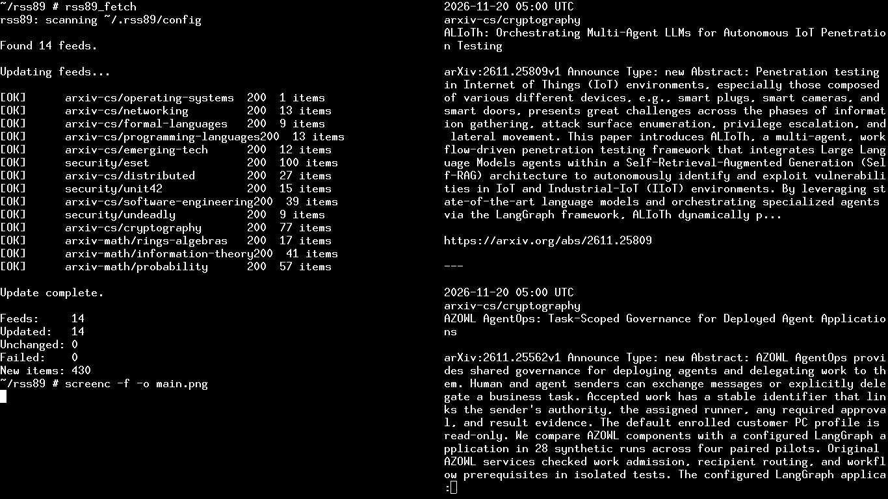

# rss89
Inspired by [sfeed](https://codemadness.org/sfeed.html) 

Minimal RSS/Atom reader in C89 (+ POSIX). Two commands, plain files, no libraries.

| Command | Purpose |
| --- | --- |
| `rss89_fetch` | fetch all feeds (max 8 parallel fetches per host) |
| `rss89_fetch <collection> <feed>` | fetch one feed, verbose |
| `rss89_plain [collection [feed]]` | print cached articles, newest first, never uses the network |

## Compile

Needs a C compiler, `make`, a POSIX system and a download tool (wget by default, curl with `FEATURES=-DRSS89_USE_CURL`).

    make

## Install

    make install                  # to /usr/local/bin (may need sudo)
    make install PREFIX=$HOME/.local

Uninstall with `make uninstall` (same `PREFIX`).

## Configure

One file per feed: `~/.rss89/config/<collection>/<feed>`, first line is the URL.

    mkdir -p ~/.rss89/config/security
    echo 'https://krebsonsecurity.com/feed' > ~/.rss89/config/security/krebs

Cached data is stored in `~/.rss89/feeds/<collection>/<feed>/feed.xml`.

Archives: every fetch that brings new items also saves a snapshot (UTC) to
`~/.rss89/feeds/<collection>/<feed>/archives/YYYY-MM-DD/HHMMSS.xml`.

##### No curl/wget?
[fetch89](https://github.com/KrzysztofMarciniak/fetch89) - Fetch a URL over HTTP or HTTPS and print the body. One C89 file.
	
	export RSS89_FETCH='fetch89 "$RSS89_URL" -o "$RSS89_OUT"'

## Usage

    rss89_fetch                     # fetch everything
    rss89_fetch security krebs      # fetch one feed
    rss89_plain                     # all cached articles
    rss89_plain security            # one collection
    rss89_plain security krebs      # one feed
    rss89_plain security krebs | less

Example output:

    2026-11-20 09:30 UTC
    security/krebs
    Article title

    Short description.

    https://krebsonsecurity.com/2026/11/article/

    ---

Cron, update every 30 minutes:

    */30 * * * * rss89_fetch >/dev/null 2>&1

## Choosing the download tool

`RSS89_FETCH` is a shell command run for every feed. Default is wget. Variables it receives:

| Variable | Meaning |
| --- | --- |
| `RSS89_URL` | URL to download |
| `RSS89_OUT` | file to write the body to |
| `RSS89_HDR` | file to write response headers to (optional; enables HTTP status, Content-Type, 304) |
| `RSS89_OLD` | previously cached feed (may not exist) |

Exit code 0 means success.

    export RSS89_FETCH='curl -sSL -D "$RSS89_HDR" -o "$RSS89_OUT" "$RSS89_URL"'

Without `RSS89_HDR` the status is assumed to be 200 and 304 is not detected.

## Build flags

    make FEATURES="-DRSS89_USE_CURL -DRSS89_NO_ARCHIVE"

| Flag | Effect |
| --- | --- |
| `-DRSS89_USE_CURL` | default fetcher is curl |
| `-DRSS89_NO_ENV` | ignore `RSS89_FETCH`, use the built-in command only |
| `-DRSS89_NO_ARCHIVE` | no archive snapshots |
| `-DRSS89_NO_HDR` | no HTTP status / 304 handling (no `date`, `grep` needed) |
| `-DRSS89_NO_PARALLEL` | no fork/pipe/wait, feeds fetched one by one |

## Exit codes

- `rss89_plain`: 1 if a requested feed is not cached
- `rss89_fetch`: 1 on error, 2 on wrong arguments

## Recommended Feeds

	# Create collection directories
	mkdir -p ~/.rss89/config

	# Security
	mkdir -p ~/.rss89/config/security
	echo 'https://www.welivesecurity.com/en/rss/feed/' > ~/.rss89/config/security/eset
	echo 'https://unit42.paloaltonetworks.com/feed/' > ~/.rss89/config/security/unit42
	echo 'https://undeadly.org/cgi?action=rss' > ~/.rss89/config/security/undeadly

	# arXiv - Computer Science
	mkdir -p ~/.rss89/config/arxiv-cs
	echo 'https://rss.arxiv.org/rss/cs.DC' > ~/.rss89/config/arxiv-cs/distributed
	echo 'https://rss.arxiv.org/rss/cs.ET' > ~/.rss89/config/arxiv-cs/emerging-tech
	echo 'https://rss.arxiv.org/rss/cs.FL' > ~/.rss89/config/arxiv-cs/formal-languages
	echo 'https://rss.arxiv.org/rss/cs.NI' > ~/.rss89/config/arxiv-cs/networking
	echo 'https://rss.arxiv.org/rss/cs.OS' > ~/.rss89/config/arxiv-cs/operating-systems
	echo 'https://rss.arxiv.org/rss/cs.PL' > ~/.rss89/config/arxiv-cs/programming-languages
	echo 'https://rss.arxiv.org/rss/cs.SE' > ~/.rss89/config/arxiv-cs/software-engineering
	echo 'https://rss.arxiv.org/rss/cs.CR' > ~/.rss89/config/arxiv-cs/cryptography

	# arXiv - Mathematics
	mkdir -p ~/.rss89/config/arxiv-math
	echo 'https://rss.arxiv.org/rss/math.IT' > ~/.rss89/config/arxiv-math/information-theory
	echo 'https://rss.arxiv.org/rss/math.PR' > ~/.rss89/config/arxiv-math/probability
	echo 'https://rss.arxiv.org/rss/math.RA' > ~/.rss89/config/arxiv-math/rings-algebras

#### Note:
Reading arXiv articles can be done with [pdfview](https://github.com/KrzysztofMarciniak/pdfview) or [web](https://github.com/krzysztofMarciniak/web).
